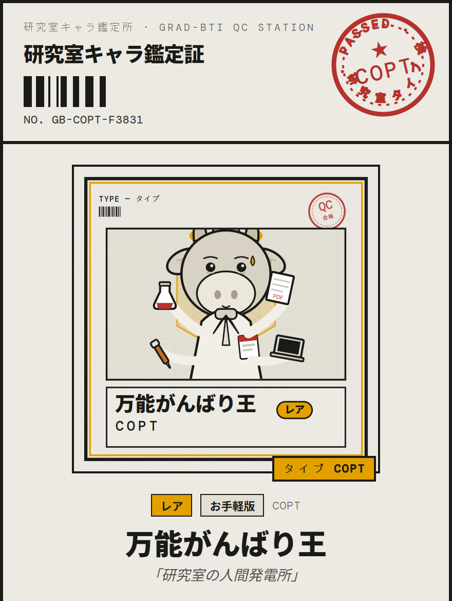
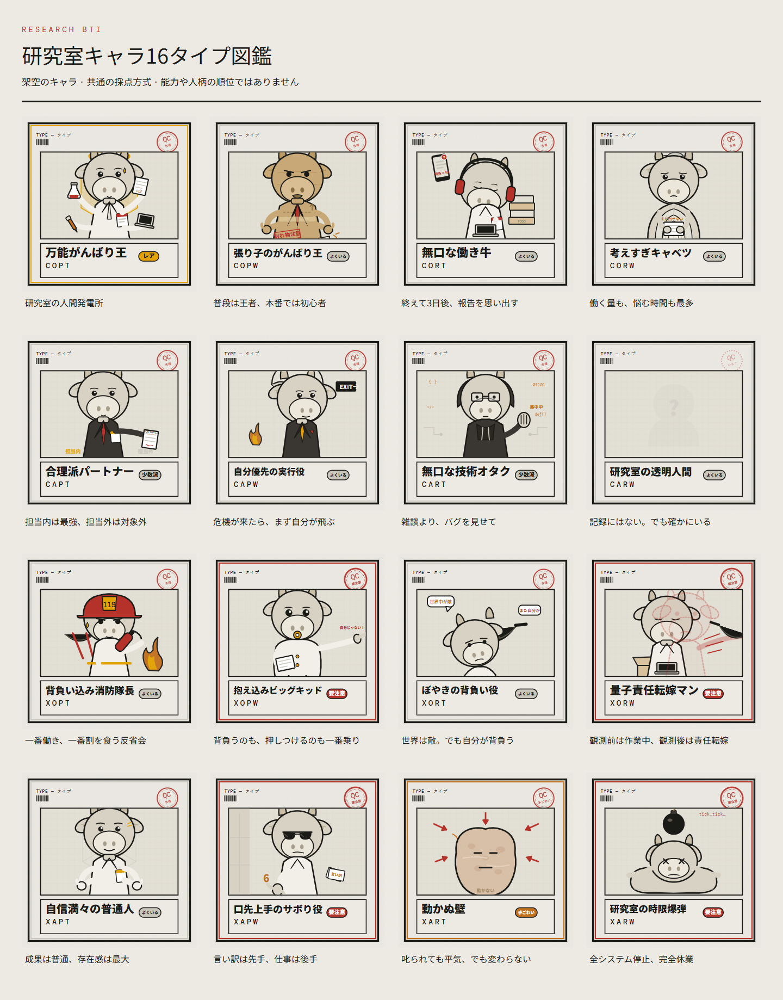

# Research BTI

**研究室での、もう一人の自分に会おう。**

[English](README.md) · [简体中文](README.zh-CN.md) · [日本語](README.ja.md)

研究チームでの働き方、伝え方、プレッシャーへの対応を振り返る、お楽しみ自己チェック。言語を選び、40問または80問の場面質問に答えると、保存・共有できる鑑定証を受け取れます。

**[テストを始める →](https://research-bti.pages.dev/?lang=ja)** · [タイプ図鑑](https://research-bti.pages.dev/?lang=ja&gallery=1) · [ソースをダウンロード](https://github.com/hujizhou35-cmd/research-bti/releases/latest)

<p align="center"></p>

*デモ回答を使い、アプリで実際に生成した鑑定証の例です。*

## 自分のペースで

| | 質問数 | 時間 |
|---|---:|---|
| お手軽版 | 40 | 約5分 |
| フル版 | 80 | 約12分 |

どちらも共通の4側面と16種類の架空のキャラを使います。結果には8方向レーダー、長所、クセ、協働のヒントが含まれます。中国語・英語・日本語で全工程を利用できます。

## このプロジェクトのきっかけ

コンテストのチームを率いる中で、責任を他人に回したり、発表審査に来なかったりする仲間に何度も出会いました。つらい経験から、「責任の担い方、情報共有、圧力への反応を、リーダーや指導教員がもっと早く知る方法はないか」と考えるようになりました。

Research BTIはその問いから生まれました。現在は探索的な自己チェックと対話のきっかけです。チームでの活躍を確実に予測できると示されたわけではなく、人の採否を決める根拠にはすべきではありません。

## 研究室に現れる16タイプ



キャラは架空で、意図的に誇張されています。自己理解のためのもので、能力や人柄の順位ではありません。

## 質問をどう改善したか

開発中はAIに16種類の行動パターンを演じてもらい、3回の回答を通じて、場面の曖昧さ、不自然な選択肢の段階、「明らかに正しい」回答への誘導を確認しました。記録には18問の書き直し、3問のテーマ変更、4つの極端な選択肢の緩和があり、採点の枠組みは維持しました。

AIの模擬回答は編集補助であり、独立した人間による検証ではありません。その後の66・71・77問の変更は、初期データ分析で別に扱います。 [開発方法](docs/methodology.md).

## 初期データと限界

本番データベースのスナップショット取得日は **2026年10月15日**、最後の回答日は **2026年7月1日** です。既知の自動テスト1件を削除した後、83件が保存されています。品質確認後の分析対象は次のとおりです。

| | 分析対象の回答数 | 第一極強度の平均 · CX / OA / PR / TW |
|---|---:|---|
| お手軽版 | 6 | 6.92 / 5.33 / 8.13 / 7.96 |
| フル版 | 45 | 5.79 / 5.48 / 7.52 / 6.56 |


発起人によると、初期募集は主に中国医科大学の学部生を対象にしていました。学校や学歴は回答ごとに確認しておらず、大学の推薦でもありません。小さな任意参加サンプルで、認証の証拠がない回答も多くあります。初期の信頼性は主に旧中国語版のもので、お手軽版には内部一貫性の問題も見られます。現行の修正版と英日翻訳版は未検証です。

[全結果・除外規則・感度分析を読む](docs/analysis/README.md).

## ローカルで動かす

Node.js 22.12以降または24 LTSが必要です。ローカルのフロントエンドで回答や鑑定証の保存を試せます。データ収集にはローカルまたはCloudflareのバックエンド設定が必要です。

```bash
npm ci
npm run dev
```

[開発とデプロイ](docs/development.md)

## プライバシーと使い方

回答完了と同意の後、Cloudflare Pages Functionsを通じてD1に保存します。氏名や学籍番号は求めません。回答、時間、ランダムなブラウザー識別子、品質確認の情報を保存し、新しい回答には言語と翻訳の版も記録します。公開するのは集計のみで、自動削除の期限は未設定です。

[プライバシーの詳細](docs/privacy.ja.md) · 自己理解とチーム内の対話の参考用です。心理診断や、妥当性が確認された人の選別ツールではありません。

## ライセンス

プロジェクト独自のコード、質問、イラストはMITライセンスです。フォントと第三者の依存関係には、それぞれのライセンスが適用されます。

[MIT](LICENSE) · [第三者ライセンス](docs/third-party-notices.md)
