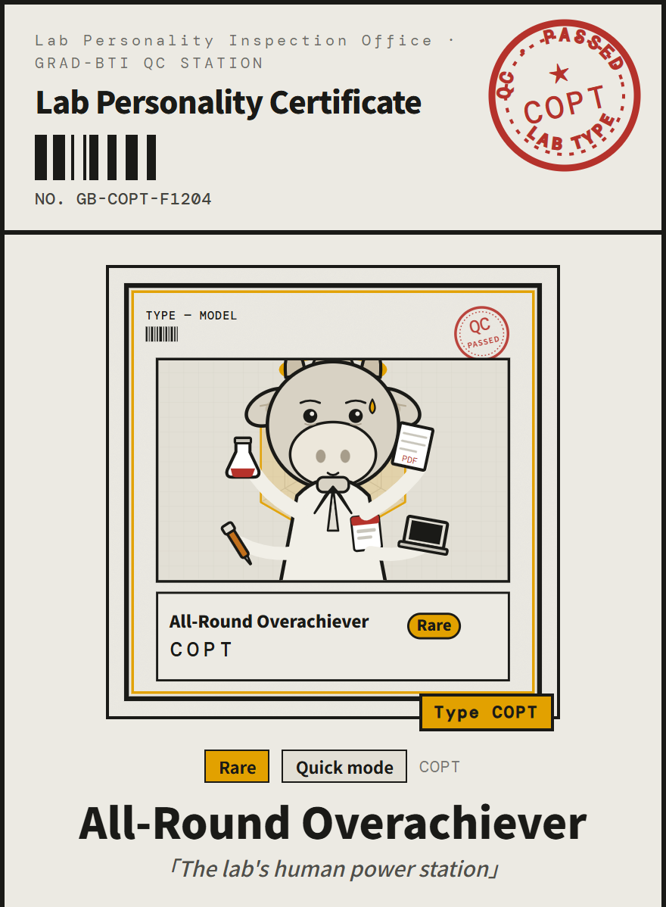
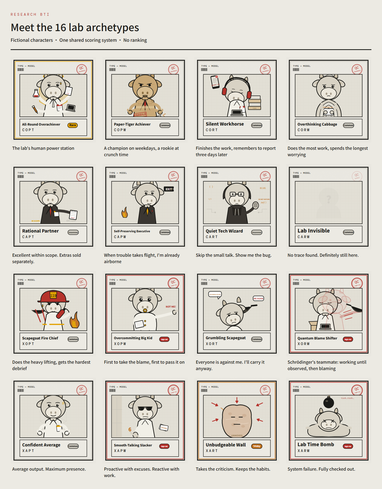

# Research BTI

**Meet your lab alter ego.**

[English](README.md) · [简体中文](README.zh-CN.md) · [日本語](README.ja.md)

A playful self-assessment of how you work, communicate and cope in a research team. Pick a language, answer 40 or 80 situational questions, and take home a shareable certificate.

**[Take the test →](https://research-bti.pages.dev/?lang=en)** · [Explore the types](https://research-bti.pages.dev/?lang=en&gallery=1) · [Download source](https://github.com/hujizhou35-cmd/research-bti/releases/latest)

<p align="center"></p>

*Example certificate from demo answers, rendered by the application.*

## Choose your pace

| | Questions | Time |
|---|---:|---|
| Quick mode | 40 | About 5 minutes |
| Full mode | 80 | About 12 minutes |

Both modes use the same four dimensions and sixteen fictional archetypes. Results include an eight-pole radar, strengths, quirks and collaboration tips. English, 中文 and 日本語 are available throughout.

## Why I built this

While leading competition teams, I repeatedly ran into teammates who passed responsibility to others or failed to show up for the defense. It was frustrating, and it left me wondering: could team leaders and supervisors get an earlier sense of how people handle responsibility, communication and pressure?

Research BTI grew out of that question. Today it is an exploratory self-assessment and conversation starter. It has not demonstrated reliable prediction of team performance and should not determine who gets selected or excluded.

## Sixteen ways to show up in the lab



The characters are fictional, deliberately exaggerated and meant for reflection—not a ranking of ability or character.

## How the questions evolved

During development, AI simulated sixteen behavioral profiles over three rounds. Those responses were used to spot ambiguous scenarios, awkward answer gradients and options that made one answer too obviously desirable. The documented revision included 18 rewritten questions, 3 topic changes and 4 softened extreme options, while preserving the scoring framework.

These simulations were an editing aid, not independent human validation. Later revisions to questions 66, 71 and 77 are tracked separately in the pilot analysis. [Development notes](docs/methodology.md).

## An initial pilot, with limits

The production snapshot was extracted on **15 October 2026**; the latest stored response was **1 July 2026**. After one known automated test was removed, 83 responses remained in storage. Quality checks retained the following analysis samples:

| | Retained responses | Mean first-pole strength · CX / OA / PR / TW |
|---|---:|---|
| Quick mode | 6 | 6.92 / 5.33 / 8.13 / 7.96 |
| Full mode | 45 | 5.79 / 5.48 / 7.52 / 6.56 |


According to the initiator, early recruitment mainly targeted undergraduates at China Medical University. That background was not verified per response, and the university does not endorse this project. Samples are small and self-selected; CAPTCHA evidence is often absent. Preliminary reliability mainly concerns the older Chinese wording, and the quick mode has an adverse internal-consistency finding. Current revised and translated versions remain unvalidated.

[Read the full findings, exclusions and sensitivity analyses](docs/analysis/README.md).

## Run it locally

Node.js 22.12+ or 24 LTS. The default local frontend lets you explore the test and export certificates; collection requires a configured local or Cloudflare backend.

```bash
npm ci
npm run dev
```

[Development and deployment](docs/development.md)

## Privacy and responsible use

Completed responses are collected with consent through Cloudflare Pages Functions and stored in D1. No name or student ID is requested. Responses include answers, timings, a random browser identifier and quality signals; new submissions also record language and translation version. Only aggregate findings are public. No automatic deletion period is configured.

[Privacy details](docs/privacy.en.md) · For self-reflection and team communication, not psychological diagnosis or a validated personnel-selection tool.

## License

Project-owned code, question text and illustrations are available under the MIT License. Bundled fonts and third-party dependencies retain their own licenses.

[MIT](LICENSE) · [Third-party notices](docs/third-party-notices.md)
