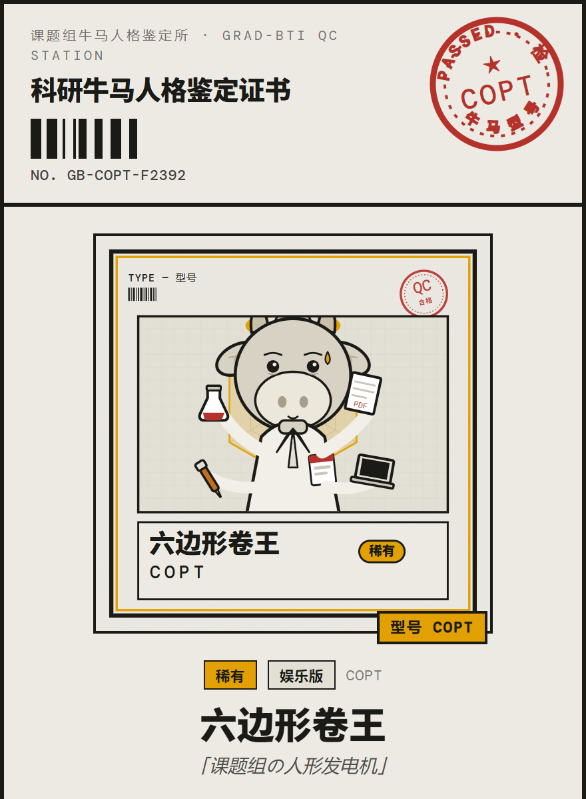
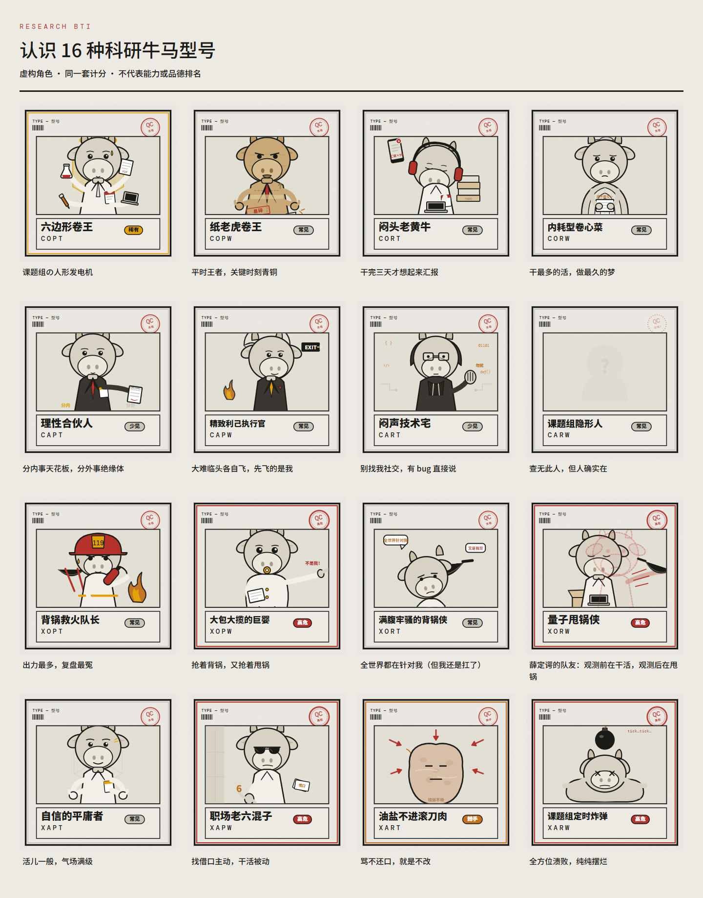

# Research BTI

**照出你在课题组的原形。**

[English](README.md) · [简体中文](README.zh-CN.md) · [日本語](README.ja.md)

一个关于科研团队协作方式的趣味自评。选择语言，回答 40 或 80 道情境题，领取一张可以保存和分享的科研牛马人格鉴定证书。

**[开始测试 →](https://research-bti.pages.dev/?lang=zh-CN)** · [浏览类型图鉴](https://research-bti.pages.dev/?lang=zh-CN&gallery=1) · [下载源码](https://github.com/hujizhou35-cmd/research-bti/releases/latest)

<p align="center"></p>

*由应用实际生成的鉴定证书示例，使用演示答案。*

## 选择适合你的节奏

| | 题量 | 时间 |
|---|---:|---|
| 娱乐版 | 40 | 约 5 分钟 |
| 严谨版 | 80 | 约 12 分钟 |

两种模式共用四个维度、16 种虚构型号。结果包含八向雷达、优点、缺点与协作建议；中文、英文、日文贯穿完整流程。

## 为什么做这个项目

在担任比赛负责人时，我曾多次遇到队友推卸责任、缺席答辩的情况。这让我很郁闷，也开始思考：能否帮助比赛负责人和导师，更早了解团队成员在责任承担、沟通和压力应对上的倾向？

研究生 BTI 由此诞生。目前它是探索性的自评与沟通工具，尚未证明能够可靠预测团队表现，不应据此决定选用或排除某个人。

## 课题组里的 16 种型号



角色是虚构且刻意夸张的标签，用于自我觉察，不是能力或品德排名。

## 题目是怎样修出来的

开发过程中，我让 AI 模拟 16 种行为原型，进行三轮作答，用来发现情境歧义、选项梯度不自然，以及「明显正确」答案过于突出的题目。现存优化记录包括 18 题重写、3 题主题调整、4 个极端选项软化，计分框架保持不变。

这些模拟是修题辅助，不是独立真人验证。后续第 66、71、77 题的修改，在样本分析中另行记录。 [开发方法说明](docs/methodology.md).

## 初步样本结果与局限

生产数据库快照提取于 **2026 年 10 月 15 日**，最新存储答卷日期为 **2026 年 7 月 1 日**。精确删除 1 份已知自动化测试答卷后，库中保留 83 份记录；质量检查后用于分析的样本如下：

| | 保留答卷数 | 第一极强度均值 · CX / OA / PR / TW |
|---|---:|---|
| 娱乐版 | 6 | 6.92 / 5.33 / 8.13 / 7.96 |
| 严谨版 | 45 | 5.79 / 5.48 / 7.52 / 6.56 |


据发起者介绍，早期主要面向中国医科大学本科生招募。学校与学历未逐份核实，本项目不代表校方。样本小且为自愿参与，验证码证据经常缺失；初步信度主要针对旧版中文题文，娱乐版也出现了不利的内部一致性结果。当前修订题文及英日翻译尚未得到验证。

[查看完整结果、排除规则与敏感性分析](docs/analysis/README.md).

## 本地运行

需要 Node.js 22.12+ 或 24 LTS。本地前端可用于体验、答题和导出证书；采集功能需要配置本地或 Cloudflare 后端。

```bash
npm ci
npm run dev
```

[开发与部署说明](docs/development.md)

## 隐私与使用边界

完成答题并同意后，答卷经 Cloudflare Pages Functions 写入 D1 数据库。不要求姓名或学号；记录包括答案、用时、随机浏览器标识和质量信号，新答卷还包含语言与翻译版本。公开展示仅使用汇总结果，目前没有自动删除期限。

[完整隐私说明](docs/privacy.zh-CN.md) · 用于自我觉察和团队沟通，不是心理诊断或已验证的人员筛选工具。

## 许可证

项目自有代码、题目文案和形象采用 MIT 许可证；字体与第三方依赖保留各自许可。

[MIT](LICENSE) · [第三方许可说明](docs/third-party-notices.md)
