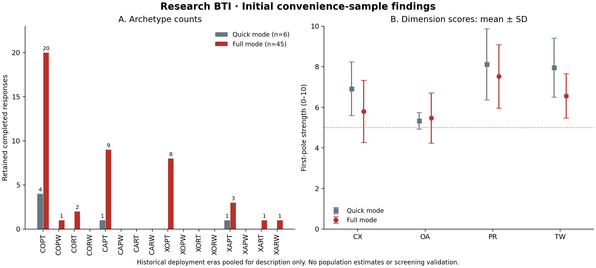

# Initial pilot findings

These are exploratory summaries of completed responses, not estimates for a university or for students generally. They do not validate personnel selection or predict team performance.

- Snapshot extracted: **2026-10-15T05:49:26.311Z**.
- Latest included server timestamp: **2026-07-01T12:17:48.151Z**.
- Before snapshot: 84 records; one owner-identified automated test was precisely removed, leaving **83**. All other production records remain stored, including analysis exclusions.
- According to the project initiator, early recruitment mainly targeted undergraduates at China Medical University. School and education level were not collected or verified per response; this is not university endorsement.
- Historical answer language was not recorded. Recruitment context and the old Chinese-only interface do not provide respondent-level language verification.
- Counts refer to responses, not verified unique people. Browser identifiers cannot establish identity or guarantee human authorship.

The plot uses raw counts from zero and a common 0–10 score scale. Error bars show **SD**, not confidence intervals. The underlying aggregate values are in [summary.json](summary.json).

## Analysis flow

| Mode | Snapshot records | Retained | Excluded from analysis |
|---|---:|---:|---:|
| Quick, 40 questions | 10 | 6 | 4 |
| Full, 80 questions | 73 | 45 | 28 |

Exclusion reasons overlap; they must not be added as if mutually exclusive.

- **Quick:** speed_two_or_more: 4; additional main straight-position exclusions: 0.
- **Full:** speed_two_or_more: 27, self_report_careless: 2; additional main straight-position exclusions: 0.

## Score distributions

First-pole strength = sum of option values / (4 × dimension question count) × 10. The first poles are internal attribution (C), over-responsibility (O), proactive communication (P), and stepping up in crises (T). Higher is not a universal judgment of better character or ability.

| Mode | Dimension | n | Mean | SD | Median | Q1 | Q3 |
|---|---|---:|---:|---:|---:|---:|---:|
| fun | CX — Locus of control | 6 | 6.917 | 1.320 | 7.250 | 6.000 | 7.938 |
| fun | OA — Responsibility | 6 | 5.333 | 0.408 | 5.375 | 5.062 | 5.688 |
| fun | PR — Communication | 6 | 8.125 | 1.752 | 8.375 | 7.062 | 9.500 |
| fun | TW — Crisis response | 6 | 7.958 | 1.453 | 8.250 | 6.875 | 8.875 |
| strict | CX — Locus of control | 45 | 5.794 | 1.535 | 5.875 | 5.000 | 6.375 |
| strict | OA — Responsibility | 45 | 5.475 | 1.237 | 5.500 | 4.750 | 6.000 |
| strict | PR — Communication | 45 | 7.522 | 1.564 | 7.625 | 6.625 | 8.500 |
| strict | TW — Crisis response | 45 | 6.564 | 1.096 | 6.125 | 5.875 | 7.000 |

## All sixteen types

| Type | Quick count | Full count |
|---|---:|---:|
| COPT | 4 | 20 |
| COPW | 0 | 1 |
| CORT | 0 | 2 |
| CORW | 0 | 0 |
| CAPT | 1 | 9 |
| CAPW | 0 | 0 |
| CART | 0 | 0 |
| CARW | 0 | 0 |
| XOPT | 0 | 8 |
| XOPW | 0 | 0 |
| XORT | 0 | 0 |
| XORW | 0 | 0 |
| XAPT | 1 | 3 |
| XAPW | 0 | 0 |
| XART | 0 | 1 |
| XARW | 0 | 1 |

## Preliminary internal consistency

**These estimates mainly describe the older Chinese question wording. They do not validate the current revised wording, English or Japanese translations, construct validity, or team-selection performance.** Alpha measures internal consistency; high alpha alone does not establish validity.

Questions 66, 71 and 77 changed without changing the historical `2.1` version label. Deployment-era classification uses server completion and consent timestamps. These are inferred eras, not proof of the exact cached frontend each respondent used. Cross-boundary sessions remain unknown and are not pooled for full-scale reliability.

The revised deployment completed on 2026-06-30 at 05:26:58.693906 UTC (13:26:58 China time). The retained full-mode pre-revision group has 44 responses; the post-revision group has only one, so its alpha is not estimable.

| Mode | Deployment era | n | Dimension | Items | Alpha | Bootstrap 95% CI |
|---|---|---:|---|---:|---:|---|
| fun | pre-June-30-deployment | 6 | CX | 10 | 0.452 | NA — see limitations |
| fun | pre-June-30-deployment | 6 | OA | 10 | -0.556 | NA — see limitations |
| fun | pre-June-30-deployment | 6 | PR | 10 | 0.910 | NA — see limitations |
| fun | pre-June-30-deployment | 6 | TW | 10 | 0.827 | NA — see limitations |
| fun | post-June-30-deployment | 0 | CX | 10 | NA | NA — see limitations |
| fun | post-June-30-deployment | 0 | OA | 10 | NA | NA — see limitations |
| fun | post-June-30-deployment | 0 | PR | 10 | NA | NA — see limitations |
| fun | post-June-30-deployment | 0 | TW | 10 | NA | NA — see limitations |
| strict | pre-June-30-deployment | 44 | CX | 20 | 0.869 | 0.707 to 0.930 |
| strict | pre-June-30-deployment | 44 | OA | 20 | 0.876 | 0.598 to 0.943 |
| strict | pre-June-30-deployment | 44 | PR | 20 | 0.920 | 0.876 to 0.945 |
| strict | pre-June-30-deployment | 44 | TW | 20 | 0.828 | 0.638 to 0.900 |
| strict | post-June-30-deployment | 1 | CX | 20 | NA | NA — see limitations |
| strict | post-June-30-deployment | 1 | OA | 20 | NA | NA — see limitations |
| strict | post-June-30-deployment | 1 | PR | 20 | NA | NA — see limitations |
| strict | post-June-30-deployment | 1 | TW | 20 | NA | NA — see limitations |

Bootstrap: 2,000 response-level resamples, percentile interval, seed 20261015. If any resample has undefined alpha because of zero total-score variance, the interval is not reported rather than silently conditioning on successful resamples. Small samples make these estimates unstable. The quick-mode OA estimate is **negative**, which is a concern, not evidence of adequate reliability.

## Sensitivity analyses

| Scenario | Quick retained | Full retained |
|---|---:|---:|
| Legacy stricter straight-position rule | 6 | 45 |
| Additionally exclude CAPTCHA absent | 0 | 6 |
| Additionally exclude self-report partial | 6 | 39 |

All scenario score summaries and type counts, including empty groups, are retained in `summary.json`. Excluding CAPTCHA-absent responses leaves no quick-mode sample and only six full-mode responses. This is a substantial quality-verification limitation; missing CAPTCHA evidence is not proof of automation.

## Reproducible methods and limitations

- Validate expected question IDs, values, option-position consistency, recorded pole, consent and recomputed scores/type. Unsupported or inconsistent records are excluded from analysis.
- Keep the earliest complete structurally valid response per browser, mode and inferred revision; then apply quality exclusions. Missing browser IDs are not merged.
- Exclude CAPTCHA fail, self-reported careless responses, and at least two speed flags: median item time <2 s, total time <1.5 s × question count, or >50% of items <1 s. Missing timing is not treated as zero.
- Main straight-position exclusion: >80% at one screen position or a continuous run ≥80% of questions. Sensitivity rule: >70% or a run ≥60%. These rules never delete raw production responses.
- Keep absent, disabled and unrecorded CAPTCHA states distinct. Analyze partial self-reports and absent verification in separate sensitivity scenarios.
- No factor-structure, predictive, cross-cultural, representative-population or selection-validity claims are made. Current revised-wording and translated-version validation remain outstanding.

Reproduction: [analysis script](../../scripts/analyze_responses.py), [figure/report script](../../scripts/render_analysis.py), [Python dependencies](../../scripts/requirements-analysis.txt). The scripts require an owner-supplied private snapshot and its manifest; individual responses and identifiers are not distributed.

Source snapshot SHA-256: `b02a69b69f925a04a8771dff2c9b641535fd434e093b9be3e962fa55c1b36ea0`.

Figure workflow reference: Kassis, T., Agarwal, V., He, Y., Patel, D., & Brueckner, A. M. (2026). Scientific Agent Skills: A Library of Procedural Knowledge for Research Agents. https://doi.org/10.48550/arXiv.2609.00065 (metadata verified on 2026-10-15).
